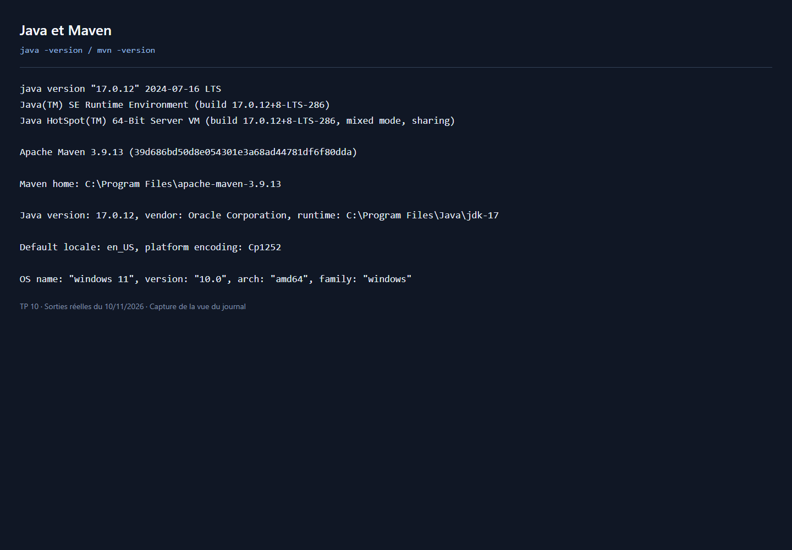
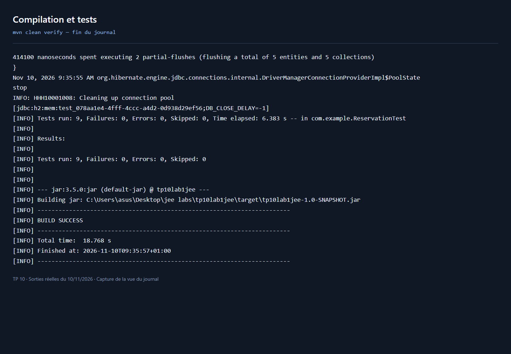
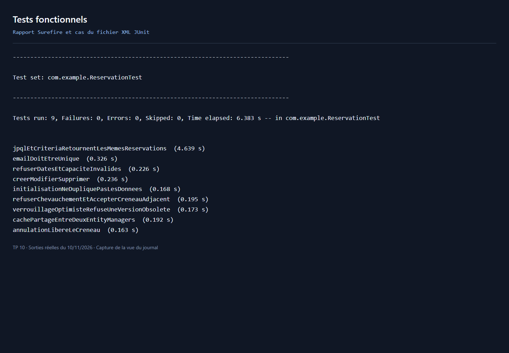
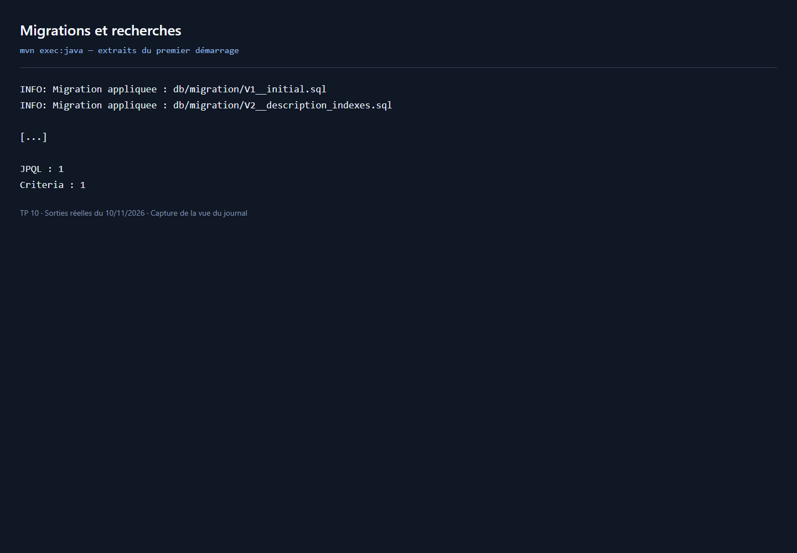
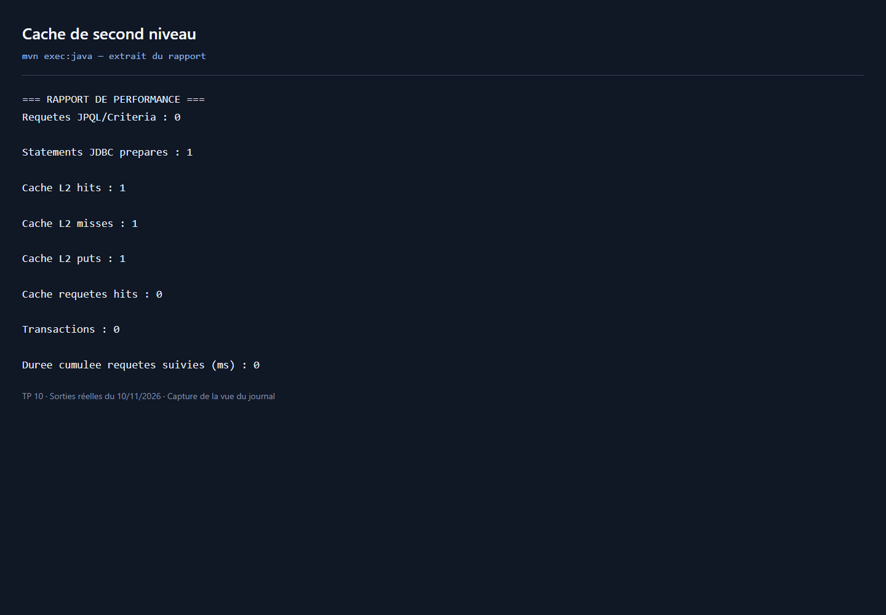
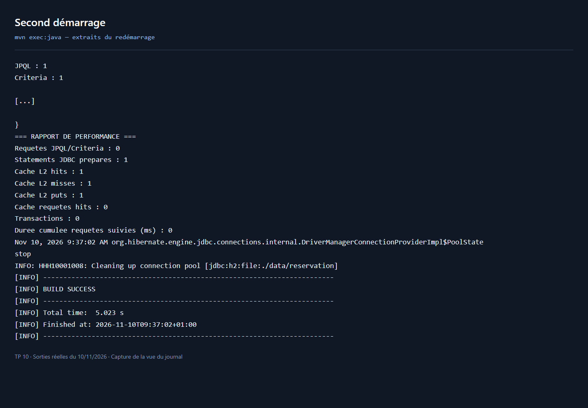

# TP 10 — Réservation de salles avec JPA et Hibernate

Application console Java : modèle enrichi, cache de second niveau, migrations SQL, requêtes JPQL/Criteria, transactions, tests JUnit et statistiques Hibernate.

## Prérequis

- JDK 17 ou supérieur, avec `JAVA_HOME` configuré.
- Maven 3.8 ou supérieur et une connexion Internet pour le téléchargement initial des dépendances.
- Aucun serveur MySQL ni serveur JEE nécessaire : la base H2 est embarquée.

## Modèle personnalisé

| Entité | Champs |
| --- | --- |
| Utilisateur | id, nom, email unique, **téléphone, département**, version |
| Salle | id, nom unique, capacité, **bâtiment, étage, description, vidéoprojecteur, accessibilité PMR, tarif horaire**, version |
| Reservation | id, salle, utilisateur, dates de début/fin, **motif, nombre de participants, statut CONFIRMEE/ANNULEE**, version |

Chaque réservation possède deux relations `ManyToOne` chargées en `LAZY`. Les trois entités utilisent `@Version` et le cache `READ_WRITE`. Les recherches chargent explicitement les salles et utilisateurs par des jointures pour éviter les lectures supplémentaires.

## Correspondance avec les étapes du TP

| Étape | Réalisation |
| --- | --- |
| 1 | Entités dans `model`, contraintes SQL et champs supplémentaires |
| 2 | Hibernate JCache + Ehcache, cache des entités et des requêtes dans `persistence.xml` |
| 3 | `DataInitializer` : trois utilisateurs, trois salles et trois réservations aux dates dynamiques |
| 4 | `ReservationTest` : neuf tests indépendants avec une base mémoire par test |
| 5 | `V1__initial.sql` puis `V2__description_indexes.sql`, dialecte H2 |
| 6 | `MigrationExecutor` : lecture UTF-8 et suivi des versions dans `schema_history` |
| 7 | `PerformanceReport` : compteurs JDBC, requêtes, cache, transactions et durées |
| 8 | `Main` : migrations avant démarrage JPA, données, recherches et démonstration du cache |
| 9 | `ReservationService.rechercherJpql` et `rechercherCriteria` |
| 10 | Transactions avec rollback, versions optimistes et verrou pessimiste sur la salle |
| 11 | Journalisation avec `java.util.logging` et propagation des erreurs |

## Règles métier et choix techniques

Le service refuse une période passée ou de durée nulle, un motif vide, un nombre de participants supérieur à la capacité et toute réservation confirmée qui chevauche le créneau demandé. Deux créneaux adjacents sont autorisés. Une annulation conserve l'historique et libère le créneau. La modification et la suppression sont également disponibles dans le service.

Le verrou pessimiste sur la salle sérialise les créations et modifications effectuées par ce service pour une même salle. Les versions optimistes détectent les mises à jour obsolètes. L'isolation JDBC est `READ_COMMITTED`. Les écritures directes par SQL ou par un autre service doivent respecter les mêmes règles de réservation.

Les migrations précèdent la création de l'EntityManagerFactory ; Hibernate valide le schéma avec `validate`, sans le créer automatiquement. La version 2 ajoute réellement la description absente du schéma initial et les index de recherche. L'unicité de l'email existe déjà dans V1.

H2 valide implicitement certaines instructions DDL : une migration interrompue peut être partiellement appliquée. Le petit exécuteur fourni suit les scripts achevés, sans garantir une reprise automatique après une interruption DDL ni des démarrages simultanés. Tester sur une copie et sauvegarder toute base utile avant une évolution. Le découpage par point-virgule convient aux scripts simples livrés, sans procédures ni littéraux contenant ce séparateur.

Le jeu de démonstration est inséré si aucun utilisateur n'existe. Un second démarrage conserve les données. Les dates sont calculées au premier peuplement ; elles ne sont pas décalées lors des démarrages suivants.

## Vérifier le TP avant le dépôt GitHub

Validation effectuée le 10 novembre 2026 avec Java 17 et Maven 3.9.13 : `mvn clean verify` réussit avec neuf tests, aucun échec et aucune erreur. L'application et son second démarrage réussissent également. Les commandes suivantes permettent de reproduire la vérification depuis le dossier contenant `pom.xml`.

Sur le poste utilisé, Java 11 est sélectionné par défaut. Pour utiliser le JDK 17 installé dans cette session PowerShell :

```powershell
$env:JAVA_HOME = 'C:\Program Files\Java\jdk-17'
$env:Path = "$env:JAVA_HOME\bin;$env:Path"
```

Le téléchargement Maven a nécessité le magasin de certificats Windows sur ce poste. En cas d'erreur `PKIX path building failed`, la configuration utilisée pour cette session est :

```powershell
$env:MAVEN_OPTS = '-Djavax.net.ssl.trustStoreType=Windows-ROOT -Djavax.net.ssl.trustStore=NONE'
```

### 1. Vérifier les outils

```powershell
java -version
mvn -version
```

Vérifier que Maven utilise un JDK 17 ou supérieur.

### 2. Compiler et tester

```powershell
mvn clean verify
```

Vérifier `BUILD SUCCESS` et neuf tests sans échec ni erreur. Les résultats se trouvent dans `target/surefire-reports`. Les tests utilisent uniquement des bases H2 en mémoire et ne modifient pas la base locale de démonstration. Certaines erreurs SQL et traces de niveau SEVERE sont attendues dans les cas de refus : le résultat JUnit détermine la réussite.

Les tests couvrent le CRUD, les chevauchements et créneaux adjacents, les dates et capacités invalides, l'annulation, l'équivalence JPQL/Criteria, le cache entre deux EntityManagers, le conflit optimiste, l'email unique et le peuplement sans doublons. Le passage répété des migrations est vérifié dans la préparation de chaque test. Ils ne simulent pas une charge concurrente de réservations.

### 3. Lancer la démonstration

```powershell
mvn exec:java
```

Vérifier le chargement des migrations puis les résultats JPQL/Criteria et le rapport de performance. La base persistante est créée dans `data/`. Aucune configuration ni mot de passe externe n'est nécessaire.

Le rapport est remis à zéro juste avant deux lectures de la même salle dans deux EntityManagers distincts. Vérifier un compteur `Cache L2 hits` positif et l'absence de second SELECT de la salle. Les compteurs de requêtes JPQL peuvent être nuls dans ce rapport final, car les recherches précèdent la remise à zéro. Les durées sont des mesures locales, pas un benchmark comparatif.

### 4. Vérifier le redémarrage

```powershell
mvn exec:java
```

Vérifier l'absence d'erreur de table ou de colonne déjà existante et l'absence de duplication des données. Pour repartir de zéro, fermer l'application puis supprimer manuellement le dossier `data/` uniquement si son contenu est jetable.

### 5. Préparer le dépôt

Les six images de `docs/screenshots/` sont des captures d'une vue des sorties réelles enregistrées pendant la validation. Certains journaux sont présentés sous forme d'extraits. La section des captures contient uniquement les images, sans commentaire d'exécution.

```powershell
git init
git status
git add pom.xml src README.md .gitignore docs
git diff --cached --check
git diff --cached
git commit -m "Finaliser le TP de reservation de salles"
git branch -M main
git remote add origin https://github.com/VOTRE_COMPTE/VOTRE_DEPOT.git
git push -u origin main
```

Créer au préalable un dépôt GitHub vide. Si le projet est déjà suivi par Git, ignorer `git init`. Si `origin` existe déjà, vérifier son URL avec `git remote -v` au lieu de l'ajouter. Examiner les fichiers indexés avant le commit : aucun fichier `data/`, `target/`, paramètre IDE ou secret ne doit être inclus.

## Captures d'écran












